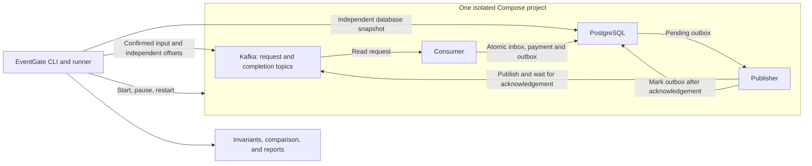

# Architecture

EventGate is one Python package with a host CLI and runner. It uses a separate
application image for the payment demo. The runner starts one Compose project per
version and scenario, observes it, and deletes only resources labeled for that run.
An application restart keeps the same project, broker, database, and control volume.

The consumer attempts to insert the request ID in the inbox. Stable writes the payment
and outbox only when that insert succeeds, in the same transaction. It confirms the
Kafka offset after PostgreSQL commits. Buggy omits that condition, so a repeated request
can create another payment even when the outbox still contains one row.

The publisher confirms the Kafka delivery before marking the outbox row. If it stops
between those operations, it can publish again. The logical completion ID and payload
must remain the same across copies. Producer idempotence does not cover a new producer
process.

The runner confirms input sends, checks committed input offsets and the outbox, then
pauses the consumer before the publisher. It reads all payment tables in one read-only
repeatable-read transaction and observes Kafka from offset 0 to a captured end offset.
No queue size or payment count reported by the application is used as a business
observation. Worker logs and durable receipts identify the instances and stages of
planned failures.

Verification is sequential: all selected Baseline scenarios, then all selected
Candidate scenarios. A business failure does not stop later pairs. Shared Docker,
output, cleanup, and interruption failures can leave remaining pairs marked NOT_RUN.

## Limits

The MVP exercises one consumer, one publisher, and one partition per topic. It does
not exercise concurrent processing, arbitrary adapters, conflicting input payloads for
one ID, production failover, or real payment processing. A single business effect for
an input ID does not imply exactly-once message delivery. App containers run without
privileged mode, a Docker socket, or host credential mounts; this is not a security
boundary for arbitrary hostile images.
