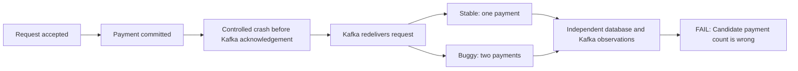

# Recorded regression example

This is a compact summary of the synthetic payment demonstration, not a new test run.
Download and open the [recorded HTML report](example-report.html) for the complete comparison.
Trailing whitespace was removed for repository formatting; report data is unchanged.
The [hosted evidence](ci.md#hosted-acceptance-results) records the exact revisions and
run links. No real payment provider or customer data was involved.

| Scenario | Stable payments | Faulty Candidate payments | Result |
| --- | --- | --- | --- |
| Duplicate delivery | 1 | 2 | FAIL |
| Crash after database commit | 1 | 2 | FAIL |

The faulty Candidate run exited 1. After the missing inbox condition was restored,
all five comparisons passed and verification exited 0. A broken environment or
incomplete evidence produces ERROR (exit 2), rather than a passing application result.

To reproduce the comparison and generate the full HTML, JSON, and JUnit reports,
follow the [Quick start](../README.md#quick-start). Timings and original run identifiers
remain in [CI evidence](ci.md#hosted-acceptance-results).
